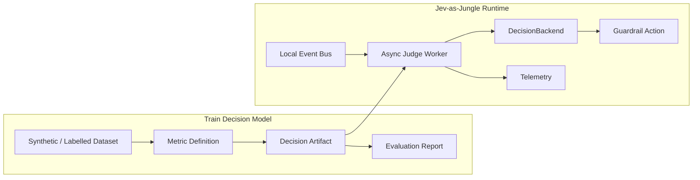

# Jev-as-Judge Engine

[](#project-status)
[](pyproject.toml)
[](pyproject.toml)
[](scripts/verify.sh)
[](LICENSE)
[](#agent-ready)

Event-driven LLM evaluation and observability experiments for judging agent
outputs in near real time.

The project explores a narrow but useful first artifact:
**Context-Grounded Faithfulness**. Given a user prompt, context chunks, and an
agent response, the engine will decide whether the response is grounded in the
provided context and emit a structured verdict for telemetry or guardrail
actions.

## Project Status

| Area | Status |
| --- | --- |
| Maturity | Experimental Engineering PoC |
| Active sprint | Sprint 1.0: Python Foundation & Decision Contracts |
| First artifact | Context-Grounded Faithfulness |
| Runtime target | Local Event Bus Worker built from core function and CLI first |
| Verification | `./scripts/verify.sh` |
| Python | `>=3.12` |
| License | MIT |

## Agent Ready

This repository is structured for agent-assisted development with a small,
explicit verification surface. The public repo keeps product artifacts in git
while local execution memory stays private and ignored.

Current agent-facing convention:

- Codex, Claude Code, Cursor, and Kimi Code can use `./scripts/verify.sh` as
  the canonical completion gate.
- Local harness files are intentionally not committed.
- Public docs describe architecture and scope without storing raw prompts,
  responses, credentials, or private execution notes.

## Planned Signals

These README signals are intentionally not shown as active badges until the
project earns them:

- Build Status: add after GitHub Actions exists.
- Windows / macOS / Linux: add after CI runs an OS matrix.
- OpenSSF Best Practices: add after the project is registered and reviewed.
- Ask DeepWiki: add after the public repository is indexed.

## Why This Exists

LLM-as-a-Judge systems are usually run offline against datasets. This project
investigates a more reactive shape: publish prompt/response/context events,
evaluate them asynchronously, and emit typed decisions without adding latency to
the primary application path.

The long-term goal is to understand how a JEV-style event-driven runtime can
apply versioned decision artifacts produced by a separate model-training or
evaluation workflow.

## Architecture Snapshot



## Current Scope

In scope for the first implementation path:

- Strict `DecisionInput`, `DecisionOutput`, and `DecisionArtifact` contracts.
- `ContextChunk[]` support for RAG-style context.
- Fail-closed validation for unsupported task types.
- Deterministic and fixture-backed decision backends before local model calls.
- CLI trace evaluation before the local event bus demo.

Deferred on purpose:

- Ollama or other local model adapter.
- Real fine-tuning workflow.
- Dashboard UI.
- Safety and schema-compliance decision artifacts.
- Production event bus, telemetry database, and artifact registry.

## Development

Install dependencies and run the canonical verification gate:

```bash
uv sync
./scripts/verify.sh
```

The verification script runs:

- `ruff check .`
- `mypy src tests`
- `pytest`

## Repository Layout

```text
docs/proposals/   Technical proposal and project narrative
LICENSE           MIT license
scripts/          Local verification and automation scripts
src/              Python package source
tests/            Unit and harness tests
```

Agent-local harness files such as `AGENTS.md`, `PROGRESS.md`,
`DECISIONS.md`, and `.agents/` are intentionally ignored by git. They are local
execution memory, not public product artifacts.

## More Detail

See [`docs/proposals/jev_as_judge_proposal.md`](docs/proposals/jev_as_judge_proposal.md)
for the technical design proposal and roadmap.
