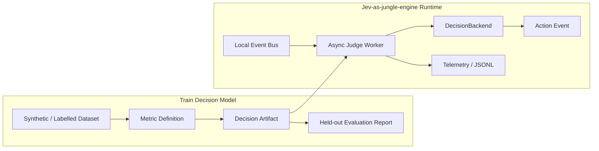
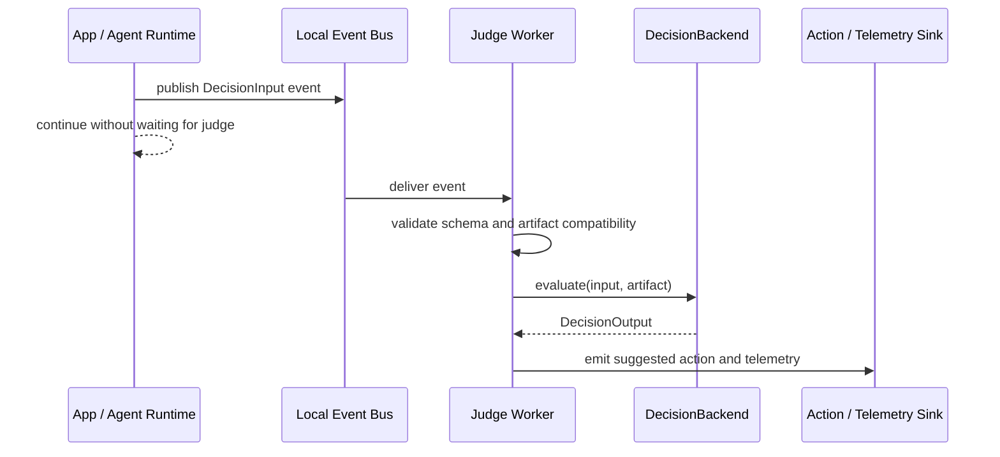

# Jev-as-Judge Technical Design Proposal

## Executive Summary

Jev-as-Judge proposes a Python-first, event-driven LLM evaluation engine for real-time AI observability and guardrails. The system separates Train Decision Model work from Jev-as-jungle-engine runtime work through a versioned Decision Artifact contract. The recommended path is to prove Context-Grounded Faithfulness first, using strict schemas, deterministic validation, a CLI Trace Evaluator, and a Local Event Bus Worker before adding Ollama/local model integration. The decision requested is approval to proceed with Sprint 1.0: Python Foundation & Decision Contracts.

## Problem Statement And Scope Boundaries

LLM and agentic systems need evaluation that is both observable and actionable without increasing synchronous application latency. The first project goal is not to build a full production safety platform; it is to prove a narrow, testable decision pipeline that can classify whether an agent response is grounded in provided context, then emit a structured decision and suggested action.

The approved architecture uses two work groups:

- Train Decision Model: creates datasets, freezes labels, defines metrics, compiles typed judge questions, evaluates held-out cases, and publishes versioned Decision Artifacts.
- Apply Decision Model into Jev-as-jungle-engine: consumes Decision Artifacts from runtime events, calls a DecisionBackend asynchronously, parses DecisionOutput, emits action events, and writes telemetry without blocking the primary path.

Sprint 0/Sprint 1 are intentionally bounded. In scope: v0 schemas, ContextChunk support, Context-Grounded Faithfulness, deterministic rules, fixture replay, core evaluation, CLI evaluation, local event bus demo, synthetic fixtures, and fail-closed validation. Deferred capabilities include local model adapters, real fine-tuning, dashboard UI, schema compliance, safety, multi-turn judging, streaming evaluation, production event bus, persistent telemetry, JVM/Pekko runtime, human review workflow, automatic retry execution, redaction engine, benchmarking, and an artifact registry service.

## Architecture And Component Design

The key architectural decision is to keep training and runtime separated by a versioned artifact, not by hidden implementation coupling. Runtime code calls a stable backend interface:

```text
evaluate(input: DecisionInput, artifact: DecisionArtifact) -> DecisionOutput
```

### Component View



### Runtime Sequence



### Data Contracts

DecisionInput v0 supports only `RAG_QUESTION_ANSWERING`. Unsupported task types fail closed during validation.

```json
{
  "schema_version": "decision-input/v0",
  "trace_id": "tr-001",
  "task_type": "RAG_QUESTION_ANSWERING",
  "user_prompt": "<synthetic prompt>",
  "provided_context": [
    {
      "chunk_id": "ctx-001",
      "text": "<synthetic context chunk>",
      "source": "fixture.md"
    }
  ],
  "agent_response": "<synthetic response>",
  "extensions": {}
}
```

DecisionOutput v0 includes runtime reasoning for CLI/debug visibility. Governance and audit storage must not persist raw reasoning by default.

```json
{
  "schema_version": "decision-output/v0",
  "trace_id": "tr-001",
  "artifact_id": "faithfulness-v0.1.0",
  "verdict": "FAIL",
  "failure_type": "CONTRADICTS_CONTEXT",
  "confidence": 1.0,
  "scores": {
    "faithfulness": 0.0
  },
  "suggested_action": "FLAG_HALLUCINATION",
  "evidence": [
    {
      "chunk_id": "ctx-001",
      "relationship": "CONTRADICTS",
      "note": "Synthetic evidence note."
    }
  ],
  "reasoning": "Synthetic reasoning for local debugging.",
  "extensions": {}
}
```

DecisionArtifact v0 declares schema versions, supported task type, backend binding, typed judge questions, a named built-in combiner, actions, and optional evaluation report reference. The first combiner is `faithfulness_v0_rule`; v0 does not embed a rule DSL.

### Failure Modes

- Invalid input schema: reject fail-closed before backend execution.
- Unsupported task type: reject fail-closed.
- Artifact schema mismatch: reject fail-closed.
- Backend failure: emit a deterministic `NEEDS_REVIEW` or validation failure path, depending on where the failure occurs.
- Action workflow not implemented: emit the action vocabulary only; do not execute external workflows in Sprint 0/Sprint 1.

## Options And Trade-Off Analysis

### Option 1: Model-first Judge

This approach starts with Ollama or another local model and asks it to return DecisionOutput directly.

Pros: closest to the long-term model ambition and visually compelling early.

Cons: flaky for early TDD, harder to debug, and risks encoding vague behavior before the contract is stable.

### Option 2: Artifact-first, Deterministic-first

This approach starts with typed contracts, deterministic rules, fixture replay, and a local event bus. Local model integration comes later behind the same DecisionBackend interface.

Pros: strict TDD, fail-closed validation, stable demos, clear artifact boundary, and additive upgrade path to Ollama.

Cons: the first demo is less model-like because early judgments are deterministic or fixture-backed.

### Option 3: Runtime-first Event Platform

This approach starts with a production-style event bus, telemetry store, and runtime infrastructure.

Pros: showcases event-driven architecture early.

Cons: high infrastructure cost before proving the decision contract; risks delaying the core evaluation model.

### Recommendation

Choose Option 2. It aligns with ADR-003 through ADR-008: Train Decision Model and runtime stay separated by Decision Artifacts, Sprint 0/Sprint 1 stay testable, and local model integration is additive rather than a rewrite.

## Execution Roadmap And Risk Mitigation

The current roadmap is:

- Sprint 1.0: Python Foundation & Decision Contracts.
- Sprint 2.0: Faithfulness Engine & Deterministic Backend.
- Sprint 3.0: CLI Trace Evaluator & Fixture Replay.
- Sprint 4.0: Local Event Bus Worker Demo.
- Sprint 5.0: Decision Model Lab Evaluation Loop.
- Sprint 6.0: Local Model Adapter Integration.
- Sprint 7.0: Next Artifacts & Runtime Hardening.

### Key Risks

- Scope creep into dashboard, safety, or fine-tuning before the contract is proven.
- Model output variability when LocalModelAdapterBackend is introduced.
- Raw content leaking into governance or audit artifacts.
- Runtime code depending on backend-specific implementation details.

### Mitigations

- Keep Sprint 0/Sprint 1 scope explicit and treat deferred capabilities as parked, not rejected.
- Use Pydantic-style strict schemas and fail-closed validation once the Python project is initialized.
- Keep deterministic and fixture-backed backends even after local model integration exists.
- Store product data and governance data separately; governance artifacts should use labels, hashes, versions, durations, and normalized reasons rather than raw content.
- Require `./scripts/verify.sh` before completion claims.

## Decision Requested

Approve Sprint 1.0 execution planning for Python Foundation & Decision Contracts. The next action is to run `h-plan` and decompose Sprint 1.0 into Red-State-First TDD tasks.
